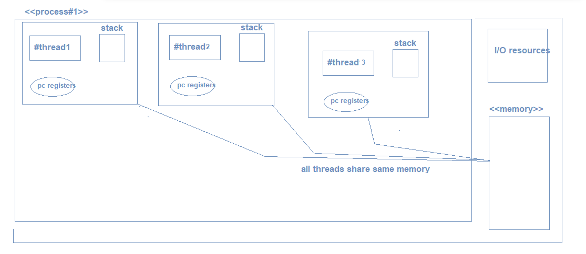
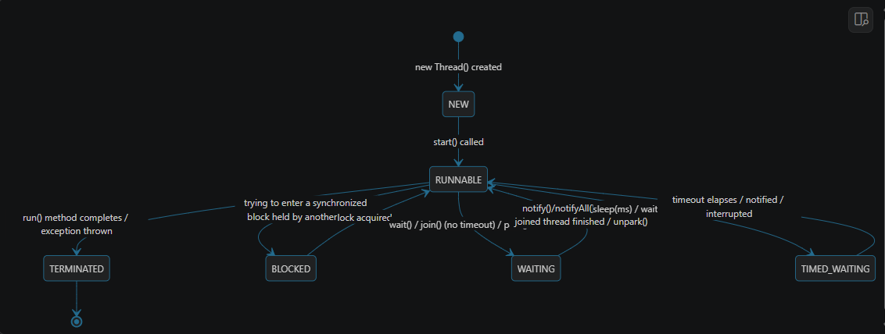

MultiThreading:
==
MultiThreading: Is the core concept that java programming , where it allowing multiple threads of a process
to execute simultaneously to use the maximum utilization of CPU and improve the app/process performance.

Why multi-threading exists?
==
- to achieve the parallelism
- to achieve responsiveness
- and also maximum utilization of CPU so that tasks would be more efficient

Thread:
==
- small unit or light-weight unit of the process.
- thread is the smallest execution unit inside the process, it act as the virtual cpu to that runs the code independently.
- shares memory with other threads

Example:
YouTube
    - Video Playback Thread
    - Comments Rendering Thread
    - Recommendation Thread
    - ADs Thread etc...

In Java , a thread is a object backed by native OS Thread, (1:1 mapping, like java requests the os to create a thread in the os and execute, it a
expensive process actually , creating native-os thread is expensive)

Process:
- A process is an running instance of the program.
- we can define as the program under execution
- inter-process communication (IPC to communicate with other processes)

OS
    - Spotify
    - YouTube
    - Instagram etc...

There are two different ways to create threads in Java:
- by extending Thread class
- by implementing Runnable interface
  this is recommended approach because it separates the "the task" (Runnable) from "execution mechanism" (Thread).

Life Cycle of Threads:

New --> Thread created but not yet running
Runnable --> Queued for running, wating for CPU time.
Running --> Threading running in the CPU.
Waiting --> Waiting for the user i/o, memory, or other thread
Time waiting --> Waits until time count down expires...continies after time out
Blocked --> Thread execution blocked.
Termiated --> execution completed.

sleep - is a static thread method, that is time bounded wait and it does not release any lock it acquired within that time-frame
just like wait() method.

Part 1 — The Interrupt Family: interrupt(), isInterrupted(), interrupted()
==
interrupt() -> triggers an interrupt event, and it just sets the boolean flag to true, nothing else. 
isInterrupted -> this is just a boolean check that interrupt flag is true or false.
interrupted -> this checks and resets the flag to false.

Part 2 — The Monitor Family: wait(), notify(), notifyAll()
==
Crucial fact: these are Object methods, NOT Thread methods

wait(): Called by a thread that currently holds the monitor lock on an object. 
It releases the lock and puts the thread into the object's wait set, pausing it 
(state WAITING or TIMED_WAITING) until another thread calls notify()/notifyAll() on that same object.

notify(): Wakes up ONE arbitrary thread waiting on that object's monitor (moves it from the wait set to the entry set, 
where it must re-acquire the lock before continuing).

notifyAll(): Wakes up ALL threads waiting on that object's monitor — they all move to the entry
set and compete to re-acquire the lock one at a time.

Part 3 — yield()
==
Definition: A static hint to the scheduler meaning "I'm not doing anything urgent right now —
if any other thread of the same priority wants CPU time, feel free to let them run instead of me." It does NOT release any locks, 
does NOT change thread state to anything blocked — the thread stays RUNNABLE, it's purely advisory.