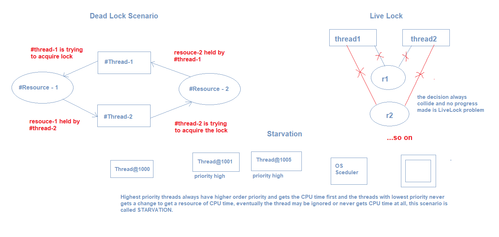

Synchronization:    
==
Is the concept that ensures that the each Thread can access the shared resource one at a time, so that the
result become predictable and expected results. This is sequential, slow because single thread can access the
resource at a time, blocking operations, in sequential operations.

We can achieve synchronization in different ways:
1. synchronized blocks
2. using final Object lock = new Object() + synchronized blocks
3. voilatile keyword -> Definition: volatile guarantees that reads and writes to a variable go directly to main memory
(not a CPU-local cache), so every thread always sees the most recently written value — this is purely a visibility guarantee,
not mutual exclusion.

Dead Lock:
==
A deadlock is a state where two or more threads are each waiting for a lock held by another thread in the group, 
forming a cycle, so that none of them can ever proceed — they're stuck forever.

Explicit Locks:
==
java.util.concurrent.locks package

ReentrantLock - its a powerful alternative to the synchronized blocks.

Atomic classes — lock-free synchronization via CAS (Compare And Swap operations)

The Four Necessary Conditions (Coffman conditions) — classic interview list
==
Mutual Exclusion — a resource can only be held by one thread at a time.
Hold and Wait — a thread holds at least one resource while waiting to acquire another.
No Preemption — a resource can't be forcibly taken away from a thread; it must be released voluntarily.
Circular Wait — a cycle of threads exists, each waiting for a resource held by the next one in the cycle.
All four must hold simultaneously for deadlock to occur — break any ONE of them, and deadlock becomes impossible.

Live Lock:
==
is a problem that threads works but they won't make any progress out of it.
Livelock: Threads are NOT blocked (they're actively running), but they keep responding to each other in a way that prevents any progress —
like two people in a hallway repeatedly stepping aside in the same direction to let the other pass, forever.

Starvation:
==
Starvation occurs when a thread is indefinitely denied access to resources or CPU because other threads keep getting preferred.

Asynchronous:
==
Is the concept where multiple threads are allowed to access the shared resources without waiting for the
previous threads to complete their execution.

Race Conditions:
==
Is the situation where the multiple threads can access the shared resources at a time, so that the final
outcome would be unpredictable, the outcome probably the positive or negative based on the timing and sequence
of the thread execution.

