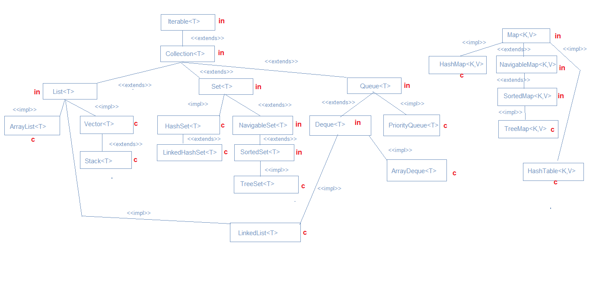

Java Collection Framework Heirarchy:
==

Advantages/Disadvantages
==
Collection	Advantage	Disadvantage
ArrayList	Fast random access, cache-friendly	Slow middle insert/delete, resize cost
LinkedList	Fast insert/delete at ends	Slow random access, more memory per element (pointers)
HashSet/HashMap	O(1) average everything	No ordering, poor worst-case with bad hashing
LinkedHashSet/Map	Predictable order + near O(1)	Slightly more memory than plain Hash versions
TreeSet/TreeMap	Always sorted, range queries	O(log n) instead of O(1)
PriorityQueue	Fast access to min/max	NOT fully sorted on iteration, O(n) search
ArrayDeque	Fast both-end ops, cache-friendly	No index-based random access
Vector/Hashtable/Stack	Thread-safe (legacy)	Single coarse lock — poor concurrency, mostly obsolete