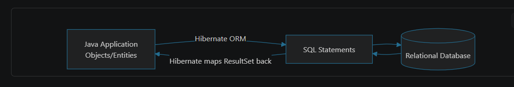
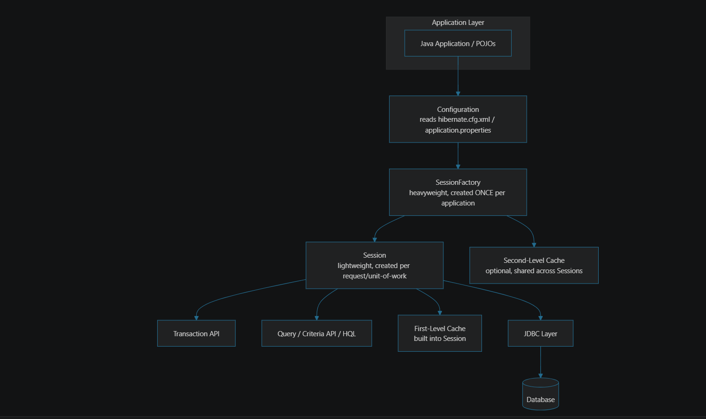
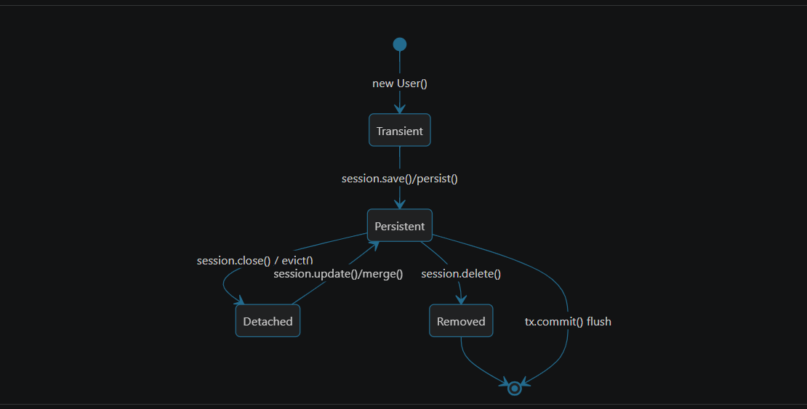
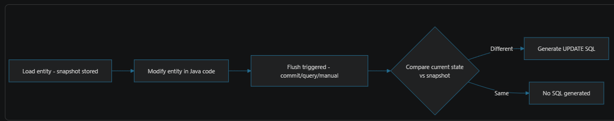
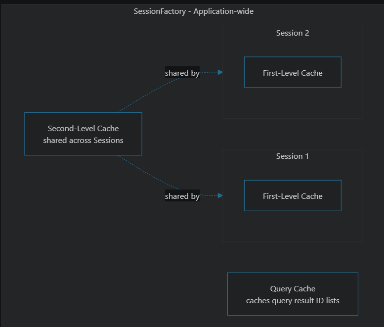
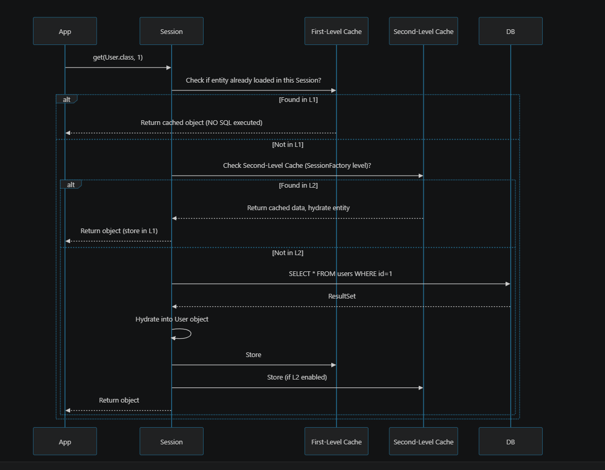

Spring Data JPA:
==
Spring data JPA is a spring project that provides a abstract layer to work on the database without boiler-plate code.
We can perform the CRUD operations on the database with easily with simple methods rather than working with core 
JPA specific methods.

Spring data-jpa provides different kind of repositories to work on the database, as follow:

    1. Repository<T, ID> (rarely used)
    2. CrudRepository<T, ID> (that provides different methods such as save, findAll, findById, deleteById, existsById, count)
    3. PagingAndSortingRepository<T, ID>
    4. JpaRepository<T, ID> (it is the combination of above 2 repositories + additional methods such as flush, saveAndFlush, getReferenceById)

JPA (Java Persistence API):
==
JPA is a standard specification (often the rules/contracts) for ORM (Object relational mapping) that works between 
java objects and db objects.

JPA is not a framework or library, it is just a standardized rulebook/contracts for ORM (i.e. specification)

SpringDataJPA
|
JPA
|
Hibernate (JPA provider/implementation)
|
DB

Persistence:
==
is saving the object state permanently into the DB

ORM (Object Relational Mapping):
==
It is paradigm that transforms the object state i.e. native java object state to native db object. (i.e. it actually converts the 
object to db object).

JPQL (Java Persistence Query Language):
==
It is object-oriented query language that works on java entities not on db table, or columns.

Query Methods:
==
findByName --> select * from employees where name = "<some_name>";
findBySalaryGreaterThan
findByNameLike
findByDepartmentIn
findByNameAndDepartment
findByNameOrAge
findBySalaryBetween etc.

JPQL - Query Annotation + named Param:
==

    @Query("""
        SELECT e FROM EMPLOYEE e
        WHERE e.name = :name
    "")
    Optional<Employee> findByName(
        @Param("name") String name
    )

JPQL - Query Annotation + Positional Args:
==

    @Query("""
    SELECT e FROM EMPLOYEE e
    WHERE e.name = ?1
    "")
    Optional<Employee> findByName(
        String name
    )

Native Queries:
==
Are directly native DB SQL queries that works directly on the tables, colmns of the DB.

    @Query("""
    SELECT * FROM EMPLOYEE e
    WHERE e.name = ?1
    "", nativeQuery = true)
    Optional<Employee> findByName(
    String name
    )

NamedQueries:
==

It refers on entities but JPQL

    @NamedQueries({
        @NamedQuery(
            name = "Employee.findByName",
            query = "SELECT e FROM EMPLOYEE e WHERE e.name = :name"
        )
    )
    })
    
    class Employee{
    ...<some feilds>
    }
    
    In repository:
    
    @Query(name = "Employee.findByName")   => it refers in entity.
    Optional<Employee> findByName(
    String name
    )

NamedNativeQueries: 
==

It refers on entities but native DB SQL

    @NamedNativeQueries({
        @NamedNativeQuery(
            name = "Employee.findByName",
            query = "SELECT * FROM EMPLOYEE e WHERE e.name = :name"
        )
    )
    })
    
    class Employee{
    ...<some feilds>
    }
    
    In repository:
    
    @Query(name = "Employee.findByName")   => it refers in entity.
    Optional<Employee> findByName(
    String name
    )

Hibernate End-End Understanding:
==

Hibernate — Complete Deep Dive (Definitions, Architecture, Internals, Caching)
PART 1: What is Hibernate? Why Does It Exist?
Definition
Hibernate is an Object-Relational Mapping (ORM) framework for Java that maps Java objects (POJOs/Entities) to relational database tables, and handles the translation between object-oriented code and SQL automatically.

It is the most popular implementation of the JPA (Java Persistence API) specification — JPA defines the standard (@Entity, @Id, EntityManager...), Hibernate is the engine that implements it (along with EclipseLink, OpenJPA as alternatives).

The Problem Hibernate Solves (Object-Relational Impedance Mismatch)
Object World	Relational World
Objects, inheritance, references	Tables, rows, foreign keys
Navigable graphs (order.getUser().getAddress())	Requires JOINs
Identity by reference (==)	Identity by primary key
No natural "has-a" collections in SQL	Collections need join tables
Without Hibernate (raw JDBC):

Problems: repetitive boilerplate, manual SQL writing, manual object mapping, manual connection/resource management, no caching, database-specific SQL dialects, manual transaction handling.

With Hibernate:

Significance / Benefits
Eliminates boilerplate JDBC code — no manual ResultSet mapping.
Database independence — Hibernate generates SQL per configured Dialect (MySQL, PostgreSQL, Oracle...); switching DBs mostly needs only a config change.
Automatic dirty checking — detects changed fields and generates UPDATE automatically, without explicit calls.
Caching — built-in multi-level caching reduces database hits (explained in detail below).
Transaction management integration — works seamlessly with Spring's @Transactional.
HQL/JPQL — object-oriented query language (query entities, not tables) that's database-agnostic.
Lazy loading — fetch related data only when accessed, improving performance.
Automatic relationship/cascade handling — @OneToMany, @ManyToOne etc. handle joins and cascading saves/deletes.
PART 2: Hibernate Architecture

Core Components
Component	Role
Configuration	Reads config (DB connection details, mapping files/annotations, dialect) and builds a SessionFactory
SessionFactory	Heavyweight, thread-safe, immutable object — created once per application (per database). Factory for Session objects. Holds the second-level cache.
Session	Lightweight, NOT thread-safe — represents a single unit of work/conversation with the database. Created per request/transaction. Holds the first-level cache. Wraps a JDBC Connection.
Transaction	Abstraction over the underlying transaction mechanism (JDBC or JTA)
Query / Criteria / HQL	Mechanisms to fetch data in an object-oriented way
ConnectionProvider	Manages JDBC connections (often delegated to a connection pool like HikariCP)
Dialect	Translates Hibernate's generated SQL to database-specific SQL syntax

Interview tip: SessionFactory : Session ratio is like Connection Pool : Connection — one expensive, reusable factory producing many cheap, short-lived units.

PART 3: Entity Lifecycle States (Very Common Interview Topic)
Every entity object managed by Hibernate exists in one of 4 states:

State	Description
Transient	Just created with new, not associated with any Session, no DB row, no identity tracked
Persistent (Managed)	Associated with an active Session, Hibernate tracks changes (dirty checking), will be synced to DB on flush/commit
Detached	Was persistent, but its Session has been closed — object still has data, but Hibernate no longer tracks changes
Removed	Marked for deletion, will be removed from DB on flush/commit

PART 4: Internal Working — What Happens Behind session.save() / get()
session.get(User.class, id) flow:

Dirty Checking & Flush (key internal mechanism)

When you modify a persistent entity's field (user.setName(...)), Hibernate doesn't immediately issue an UPDATE.
At flush time (automatic before query execution, or on tx.commit(), or session.flush()), Hibernate compares the entity's current state vs. a snapshot taken when it was loaded — this comparison is dirty checking.
If different, it generates an UPDATE SQL automatically — you never write UPDATE SQL yourself.

Write-Behind Behavior
Hibernate batches and delays SQL execution until flush time wherever possible — this is called write-behind. Multiple changes within a transaction can be optimized into fewer/batched SQL statements.

PART 5: Caching Mechanisms in Hibernate (Very Important for Interviews)

1) First-Level Cache (L1)
   Scope: Per Session (mandatory, always ON, cannot be disabled).
   Lifetime: As long as the Session is open.
   Purpose: Avoid repeated SQL for the same entity within the same Session.

Interview point: L1 cache guarantees that within one Session, you always get the same Java object reference for the same entity ID — this is called Session-level identity guarantee.

2) Second-Level Cache (L2)
   Scope: SessionFactory-wide — shared across multiple Sessions (and potentially across the whole application/cluster).
   Lifetime: Application lifetime (until evicted/expired).
   Disabled by default — must be explicitly enabled with a cache provider (Ehcache, Caffeine, Redis, Infinispan).

Why it matters: Without L2, if Session A loads Product(id=5) and closes, then Session B loads Product(id=5) again — a fresh SQL query runs again, because L1 cache died with Session A. L2 cache solves this by caching at the SessionFactory level, surviving across Sessions.

Cache Concurrency Strategies (L2) — common interview detail
Strategy	Use case
READ_ONLY	Data never changes (e.g., reference/lookup tables) — fastest, simplest
READ_WRITE	Data changes occasionally, needs consistency guarantees (uses locking)
NONSTRICT_READ_WRITE	Data rarely changes, slight inconsistency acceptable, better performance
TRANSACTIONAL	Full JTA transactional cache consistency (e.g., with JBoss/Infinispan)
3) Query Cache
   Caches the result of a query (actually just the list of entity IDs, not full objects) so re-running the exact same query (with same parameters) skips hitting the DB for the ID list — actual entity data still comes from L1/L2.
   Must be used together with L2 cache to be effective.
   Disabled by default; must opt-in per query.

Interview nuance: Query cache is invalidated automatically whenever any row of the underlying entity table changes (via an UpdateTimestampsCache) — so it's only beneficial for tables that change infrequently but are queried often.

Cache Comparison Table
Feature	L1 (First-Level)	L2 (Second-Level)	Query Cache
Scope	Session	SessionFactory (app-wide)	SessionFactory
Enabled by default	✅ Yes, always	❌ No	❌ No
Can be disabled	❌ No	✅ Yes (default off)	✅ Yes (default off)
Stores	Entity objects	Entity data (disassembled state)	Entity ID lists for a query
Shared across sessions	❌ No	✅ Yes	✅ Yes
Needs external provider	No	Yes (Ehcache/Redis/Caffeine)	Yes (same as L2)
PART 6: Fetching Strategies — Lazy vs Eager

Fetch Type	Behavior	Default for
LAZY	Related entity/collection loaded only when accessed (user.getOrders() triggers a separate SQL query)	@OneToMany, @ManyToMany
EAGER	Related entity loaded immediately with the parent (via JOIN or separate immediate SELECT)	@ManyToOne, @OneToOne
The Classic "N+1 Select Problem" (Must-know Interview Topic)

Problem: 1 query to fetch users + N queries (one per user) to lazily fetch each user's orders = N+1 queries total — a major performance killer.

Fixes:

JOIN FETCH in HQL/JPQL:

@EntityGraph (Spring Data JPA):

Batch fetching (@BatchSize) — groups lazy loads into batches instead of one-by-one.

PART 7: HQL vs JPQL vs Criteria API vs Native SQL
Approach	Example	Notes
HQL (Hibernate Query Language)	FROM User WHERE age > 18	Object-oriented, queries entities/fields (not table/column names), database-independent
JPQL	Same syntax as HQL (JPA standard subset)	Portable across JPA providers (Hibernate, EclipseLink)
Criteria API	CriteriaBuilder, CriteriaQuery	Type-safe, programmatic query building — good for dynamic queries built at runtime
Native SQL	session.createNativeQuery("SELECT * FROM users")	Raw SQL, database-specific, used for complex/optimized queries HQL can't express

PART 8: Transactions & Isolation (brief, commonly paired with Hibernate questions)

Hibernate transactions typically delegate to the underlying JDBC transaction (or JTA in distributed scenarios).
With Spring, @Transactional manages this automatically via AOP proxy (no manual begin/commit/rollback needed).
PART 9: Optimistic vs Pessimistic Locking

Optimistic Locking: Uses a @Version column — checked at UPDATE time (WHERE id=? AND version=?); if version mismatches (someone else updated it first), throws OptimisticLockException. No DB locks held — good for high-read, low-conflict scenarios.
Pessimistic Locking: Explicitly locks the row in the DB (SELECT ... FOR UPDATE) for the duration of the transaction, preventing others from modifying it concurrently.

PART 10: Summary Table — Quick Recall
Concept	Key Point
Hibernate	ORM framework, implements JPA, maps objects ↔ relational tables
SessionFactory	Heavyweight, one per app, thread-safe, holds L2 cache
Session	Lightweight, per-unit-of-work, NOT thread-safe, holds L1 cache
Entity states	Transient → Persistent → Detached / Removed
Dirty checking	Compares snapshot vs current state at flush time, auto-generates UPDATE
L1 Cache	Session-scoped, always on, guarantees same object reference per ID
L2 Cache	SessionFactory-scoped, opt-in, needs external provider (Ehcache/Redis)
Query Cache	Caches query ID result lists, needs L2 enabled, invalidated on table change
Lazy vs Eager	Lazy = load on access; Eager = load immediately; mind the N+1 problem
N+1 problem	Fix with JOIN FETCH, @EntityGraph, or @BatchSize
Locking	Optimistic (@Version, no locks) vs Pessimistic (SELECT FOR UPDATE)
PART 11: Rapid-Fire Interview Q&A
Q: What is Hibernate and why use it over JDBC?
A: An ORM framework implementing JPA that maps Java objects to DB tables, eliminating manual SQL/ResultSet boilerplate, adding caching, dirty checking, lazy loading, and DB portability via Dialects.

Q: Difference between Session and SessionFactory?
A: SessionFactory is heavyweight, thread-safe, created once per application, holds L2 cache. Session is lightweight, not thread-safe, created per unit of work, holds L1 cache, wraps a JDBC connection.

Q: What is dirty checking?
A: Hibernate compares an entity's current state against a snapshot taken at load time, during flush, and auto-generates UPDATE SQL for changed fields — no explicit update call needed.

Q: Difference between save(), persist(), merge(), update()?
A: save() returns the generated ID, works outside a transaction in some cases (legacy Hibernate API); persist() is the JPA-standard equivalent, void return, must be in transaction. update() reattaches a detached entity and always issues an UPDATE (fails if entity doesn't exist). merge() copies detached entity's state onto a persistent entity (load existing + apply changes) and returns the merged managed instance.

Q: What is the N+1 select problem and how to fix it?
A: Fetching a list (1 query) then lazily loading an association for each item individually (N queries) = N+1 total. Fix with JOIN FETCH, @EntityGraph, or @BatchSize.

Q: Difference between L1 and L2 cache?
A: L1 is Session-scoped, always on, cannot disable. L2 is SessionFactory-scoped (app-wide), off by default, needs external cache provider, shared across Sessions/users.

Q: What triggers a flush?
A: tx.commit(), explicit session.flush(), or before executing a query that could be affected by pending changes (Hibernate auto-flushes to keep query results consistent).

Q: Why does @Transactional fail on self-invocation?
A: Because the AOP proxy wrapping the bean is bypassed when a method calls another method on this directly — only external calls through the proxy trigger transaction/caching/locking behavior.

Q: What's the difference between optimistic and pessimistic locking?
A: Optimistic assumes conflicts are rare — checks a @Version column at update time, throws an exception on conflict, no DB locks held. Pessimistic locks the row immediately (SELECT FOR UPDATE), blocking other transactions until released — suited for high-contention scenarios.

Q: What is the difference between HQL and SQL?
A: HQL queries entities and their fields (object-oriented, DB-independent); SQL queries tables and columns directly (DB-specific).

